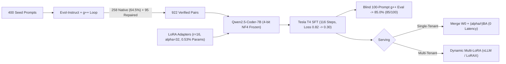

# 1. Fine-Tuning LLMs with LoRA & QLoRA

### Architecture & Design Choices
* **When to Fine-Tune vs. RAG / Prompting:** Use RAG for altering facts and for general reasoning via prompting. Use QLoRA when you need to enforce a strict output format, when you're dealing with domain specific syntax (e.g. compilable C++) or when you're trying to distil the behaviour down into a smaller model.
* **Data & Loss Masking:** Formatted examples in ChatML and masked prompt tokens (labels = -100) so that the cross-entropy loss only applies to the assistant completions.
* **LoRA Placement:** Froze base weights $W_0$ and injected low-rank adapters ($h = W_0x + \frac{\alpha}{r}BAx$, $r=16, \alpha=32$) across **all linear projections** (`q/k/v/o_proj` + `gate/up/down_proj`), matching full fine-tuning quality better than attention-only adapters.
* **QLoRA Memory Stack:** Used 4-bit NF4 base weights, double quantization (quantizing scaling constants to FP8), and paged 8-bit AdamW optimizers to fit a 7B run inside a single 14.5 GB Tesla T4 without OOMs.
* **Deployment Trade-Off:** Merge adapters into the FP16 weights for zero inference overhead on single tenant endpoints. Leave adapters unmerged on vLLM/LoRAX when serving multiple tenants off a single base model.

| Approach | 7B VRAM | Trainable Params | Inference Overhead | Best Fit |
| :--- | :--- | :--- | :--- | :--- |
| **Full Fine-Tuning** | ~112 GB | 100% | None | Heavy domain pre-training |
| **LoRA (BF16/FP16)** | ~28 GB | ~0.5%–2% | None (merged) | Multi-GPU, max precision |
| **QLoRA (4-bit NF4)** | ~8 GB | ~0.5%–2% | Slight unless merged | Single-GPU training (T4/L4) |

### Production Run & Blind Evaluation (`Qwen2.5-Coder-7B`)
* **Dataset Pipeline:** Passed 400 seeds through Evol-Instruct + `g++` compilation checks. **258/400 (64.5%)** passed natively, **95** succeeded after feeding `g++` `stderr` back for self-healing repair, and **47** were dropped $\rightarrow$ **922 verified training pairs**[cite: 6].
* **Training Logs:** Trained `40.37M` parameters (`0.53%`) on 1x Tesla T4 (`116` steps, `15m 33s`). Loss dropped from **`0.822`** (step 1) to **`0.304`** (step 115).
  * *Real bug hit:* At step 116, `Trainer._save()` hit a `PicklingError` on `SFTConfig` due to Unsloth's dynamic class patching when serializing `training_args.bin`. Fixed by saving adapter weights directly via `model.save_pretrained()`.
* **Blind Held-Out Benchmark (`100` Unseen Prompts):** Improved first-pass `g++` compilation from the **64.5%** un-repaired baseline to **85.0% (85/100)**[cite: 5, 6].
  * **15 Failures Root-Caused:** `3` environment/linker mismatches (Win32 `LARGE_INTEGER`, missing `-lcurl` / `boost` in Linux sandbox)[cite: 5], `3` prompt truncations (`>2048` tokens) / markdown fence artifacts[cite: 5], and `9` C++ template/header edge cases on cross-language transpilation prompts[cite: 5].
