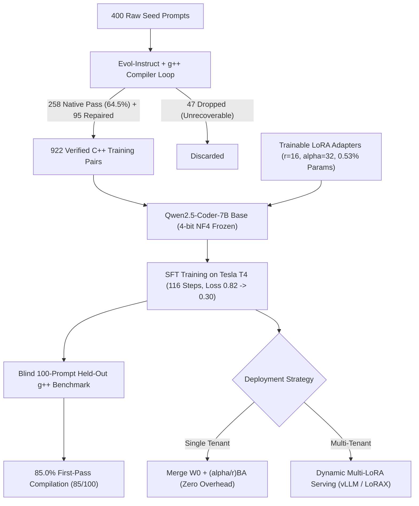

# 1. Fine-Tuning LLMs Using LoRA & QLoRA

## System Architecture & Evaluation Pipeline

## Architectural Breakdown

* **When to Fine-Tune vs. Prompting / RAG:** Use **RAG** for dynamic factual knowledge and **prompting/few-shot** for general reasoning. Use **QLoRA/LoRA fine-tuning** when enforcing strict output syntax, domain-specific idiomatic patterns (e.g., systems C++ compilation compliance), or distilling behavior into a smaller, lower-latency model.
* **Data Preparation & Loss Masking:** Format examples strictly in the model's native ChatML template (`<|im_start|>user` / `<|im_start|>assistant`) and mask prompt tokens (`labels = -100`) so cross-entropy loss is computed exclusively on assistant completions.
* **LoRA Mechanics:** Freezes pre-trained weights $W_0 \in \mathbb{R}^{d \times k}$ and injects trainable low-rank matrices $B \in \mathbb{R}^{d \times r}$ and $A \in \mathbb{R}^{r \times k}$:
  $$h = W_0 x + \frac{\alpha}{r} B A x$$
  $A$ is initialized with Gaussian noise and $B$ with zeros so training starts as an identity mapping. Target **all linear projections** (`q_proj`, `k_proj`, `v_proj`, `o_proj`, `gate_proj`, `up_proj`, `down_proj`) rather than attention layers alone to match full fine-tuning expressivity.
* **QLoRA Memory Optimizations:**
  1. **4-bit NormalFloat (NF4):** Information-theoretically optimal 4-bit quantization for normally distributed pre-trained weights, dequantized on-the-fly to `fp16`/`bf16` during forward/backward passes.
  2. **Double Quantization:** Quantizes the 32-bit quantization scaling constants themselves to 8-bit floats, saving ~0.37 bits per parameter.
  3. **Paged Optimizers:** Leverages NVIDIA Unified Memory to page optimizer states between GPU VRAM and host CPU RAM during activation spikes, preventing OOM crashes on 15 GB GPUs.
* **Merge vs. Dynamic Serving:** Merging adapters (`W_merged = W_0 + (alpha/r)BA`) adds **zero inference latency** for single-tenant deployments, while unmerged adapters allow a single base model in vLLM/LoRAX to serve dozens of tenant adapters concurrently.

## Trade-Offs

| Method | VRAM (7B Model) | Trainable Params | Inference Latency Overhead | Ideal Use Case |
| :--- | :--- | :--- | :--- | :--- |
| **Full Fine-Tuning** | ~112 GB | 100% | None | Continued pre-training, heavy domain shift |
| **LoRA (FP16/BF16)** | ~24–32 GB | ~0.5% – 2% | None (when merged) | Multi-GPU setups prioritizing maximum precision |
| **QLoRA (4-bit NF4)** | ~6–10 GB | ~0.5% – 2% | Slight dequant overhead unless merged | Single-GPU training (T4/L4), rapid iteration |

## Production Run: `Qwen2.5-Coder-7B` C++ Systems Specialization

* **Data Curation Pipeline:** Passed 400 seed prompts through an Evol-Instruct + `g++` compiler verification loop. **258/400 (64.5%)** compiled natively on the first pass, **95** succeeded after feeding `g++` `stderr` back for self-healing repair, and **47** were dropped—producing a curated dataset of **922 verified pairs**.
* **Training Configuration & Logs:**
  * **Hardware:** 1x NVIDIA Tesla T4 (`14.56 GB` VRAM, Turing architecture `SM 7.5`, FP16 compute with `bf16=False`).
  * **Parameters:** `40,370,176` trainable out of `7,655,986,688` total (**0.53%**).
  * **Optimization:** Effective batch size `8` (`batch_size=2`, `grad_accum=4`), `116` total steps (`15m 33s`). Training loss decreased from **`0.822`** (Step 1) to **`0.304`** (Step 115, minimum **`0.230`** at Step 105).
  * **Real Engineering Scar (Checkpoint Serialization):** At Step 116, `Trainer._save()` threw `PicklingError: Can't pickle <class 'trl.trainer.sft_config.SFTConfig'>` because Unsloth's dynamic class patching altered `SFTConfig` module identity when `torch.save(self.args)` serialized `training_args.bin`. Fixed by saving adapter weights directly via `model.save_pretrained()` rather than pickling trainer state.

### Blind Held-Out Evaluation & Root-Cause Failure Analysis (`100` Unseen Prompts)

Evaluated on **100 blind held-out prompts** (`max_new_tokens=1500`, `max_seq_length=2048`):
* **Un-repaired First-Pass Compilation Baseline:** `64.5%` (`258/400` native pass rate)
* **QLoRA Fine-Tuned Blind Benchmark Score:** **`85.0%` (`85/100` first-pass `g++` compilation)**

| Failure Category | Count | Sample Compiler Error from Logs | Root Cause & Fix |
| :--- | :--- | :--- | :--- |
| **Environment & Linker Mismatches** | 3 | `error: 'LARGE_INTEGER' does not name a type`; `error: 'boost' does not name a type`; `undefined reference` (`libcurl`) | Model generated Win32 APIs (`<windows.h>`) or third-party headers/libs in a standard Linux `g++` sandbox without `-lcurl`. Fix via explicit system prompt constraints (`POSIX C++17 STL only`). |
| **Context Truncation & Extraction Artifacts** | 3 | `Input IDs length 2115 > max sequence length 2048`; `error: stray '`' in program` | Long prompt truncated setup definitions at 2048 tokens; regex extractor missed a backtick edge case. Fix by extending RoPE context to `4096` and tightening AST/fence parsing. |
| **C++ Type-System & Header Edge Cases** | 9 | `error: 'list_any' does not name a type`; missing `<functional>` / template instantiation errors | Complex multi-language transpilation prompts (Python/Rust -> C++) triggered missing STL includes or invalid type aliases. Fix by oversampling transpilation repairs in v4 data. |
