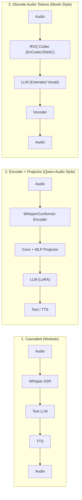

# 2. Converting a Text LLM to a Speech LLM *(Design-Only)*

> **Note:** Architecture and trade-off analysis only. *(Happy to build and share the cascaded `Whisper -> Ollama -> Kokoro TTS` prototype as a follow-up.)*

### Three Approaches & Trade-Offs
1. **Cascaded (`ASR -> Text LLM -> TTS`):** Easiest to ship, debug, and guard with text filters, but latency stacks across 3 models and vocal emotion/prosody is lost at the ASR text bottleneck.
2. **Speech Encoder + Projector (`Qwen-Audio` / `SALMONN` style):** Feeds frozen acoustic encoder frames (~50 Hz) through a strided conv + MLP downsampler (~4x–8x compression) directly into the LLM's embedding space. Trained in two stages: align the projector on ASR/audio-captioning data first, then LoRA-tune the LLM on speech conversations.
3. **Discrete Audio Tokens (`EnCodec` / `SNAC` / `Moshi` style):** Tokenizes audio via Residual Vector Quantization (RVQ), extends the LLM's vocabulary, and autoregressively generates interleaved text + audio tokens. Lowest latency (`<300ms`) and full prosody control, but requires massive paired audio data and compute.

| Dimension | Cascaded | Encoder + Projector | Discrete Audio Tokens |
| :--- | :--- | :--- | :--- |
| **Time-to-First-Audio** | `800ms – 2.5s` | `350ms – 700ms` | `< 300ms` |
| **Prosody & Emotion** | Lost at ASR | Preserved on input | Preserved end-to-end |
| **Data & Compute Cost** | Low | Moderate | Very High |
| **Indic / Code-Switching** | High (with Indic ASR/TTS) | Good (Whisper-v3 / Conformer) | High risk of pronunciation drift |

### Streaming, Metrics & Recommendation
* **Streaming:** Use VAD endpointing (`~200ms` silence) and stream LLM tokens into a clause/punctuation chunker so TTS synthesizes sentence-by-sentence while the LLM is still decoding.
* **Evaluation:** Track **WER/CER** (transcription accuracy), **MOS** (naturalness), and **TTFT / Real-Time Factor** ($\text{RTF} = \frac{\text{compute time}}{\text{audio duration}} < 0.3$ for real-time voice).
* **Indic Languages:** Code-switching (Hinglish/Tenglish/Tanglish) breaks standard BPE tokenizers—use multilingual acoustic encoders (IndicWhisper/Conformer) and script normalization before TTS.
* **Recommendation:** Start in production with **Sentence-Streamed Cascaded** for reliability, text guardrails, and Indic accuracy; move to **Encoder + Projector** when input prosody/intent matters; reserve **Discrete Tokens** for large-scale dedicated voice models.
