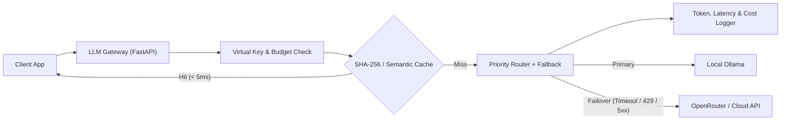

# 3. LLM Gateways

### Architecture & Trade-Offs
* **Single Control Plane:** Exposes one OpenAI-compatible `/v1/chat/completions` interface so client apps never import vendor SDKs or hardcode API keys; model swaps happen via gateway config.
* **Routing & Failover:** Routes to low-cost/local inference first and fails over automatically on timeouts, `429`s, or `5xx` errors *(modeled on the local-Ollama-to-OpenRouter fallback I built in **Sanctum**)*.
* **Caching:** Exact SHA-256 hashing on deterministic (`temperature=0`) requests gives `<5ms` zero-token hits; semantic caching (embedding similarity `>0.96`) cuts repetitive query spend by 20–40% at the cost of a vector lookup and slight false-positive risk.
* **Governance & Observability:** Issues per-team virtual keys with rate limits, hard dollar budgets, and structured JSON logs (`req_id`, `provider`, `fallback_triggered`, `latency_ms`, `tokens`, `cost_usd`).
* **Build vs. Buy:** Adopt **LiteLLM** (open-source) or **Portkey / Kong AI Gateway** (managed) when you need 100+ provider adapters out of the box; build a **thin FastAPI proxy** (`gateway.py`) when you want `<3ms` overhead and custom routing/guardrail hooks.

**Code:** [`gateway.py`](./gateway.py) *(verified together with `04-llm-guardrails`)*.
