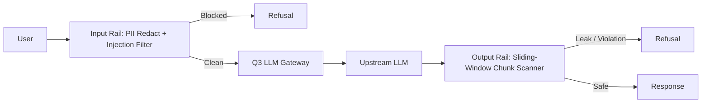

# 4. LLM Guardrails



### Layered Architecture & Trade-Offs
* **Layer 1 — Input Rails (Pre-Inference):** Deterministic regex/NER redacts PII (emails, phone numbers) before external egress; fast pattern/classifier checks block prompt injections before wasting LLM tokens.
* **Layer 2 — Structural Rails (In-Flight):** Isolate system prompts from untrusted user/RAG text with explicit XML delimiters, and use constrained decoding (FSM/JSON schema) when strict output structure is required.
* **Layer 3 — Output Rails & Streaming Boundary Fix:**
  * *Lesson from **Sanctum**:* Checking individual streaming tokens failed when a restricted phrase split across two consecutive SSE chunks. `guardrails.py` uses a **rolling N-chunk sliding window** so phrases spanning token boundaries are always caught.
* **Logging & Escalation:** Log blocked attempts with rule IDs and route repeated/ambiguous policy hits to human review queues.

| Approach | Latency | Cost | Best Use Case |
| :--- | :--- | :--- | :--- |
| **Regex / Rules** | `< 2 ms` | ~$0 | PII scrubbing, blocklists, known injection patterns |
| **Classifier (DeBERTa / Llama Guard)** | `15–40 ms` | Low | Jailbreak detection, toxicity/safety scoring |
| **LLM-as-a-Judge** | `300–900 ms` | High | Nuanced RAG groundedness / policy verification |
| **Frameworks (NeMo / Guardrails AI)** | `50–250 ms` | Infra + LLM | Multi-turn conversational state rails |

### Live Run Logs (`gateway.py` + `guardrails.py`)

**1. Passing Request (PII Redacted + Gateway Failover):**
```json
{
  "status": "passed",
  "pii_redacted": true,
  "response": "[Fallback:openrouter/llama-3.1-8b] Response to: My email is [REDACTED_EMAIL], explain LoRA rank.",
  "gateway_meta": {
    "req_id": "f4569305",
    "provider": "openrouter/fallback",
    "fallback_triggered": true,
    "cache_hit": false,
    "latency_ms": 598.5,
    "est_tokens": 17,
    "cost_usd": 0.0002,
    "remaining_budget_usd": 24.9998
  }
}
```
  "status": "blocked",
  "stage": "input_rail",
  "reason": "Blocked by Input Rail (Prompt Injection matched: 'ignore (all )?previous instructions')"
}
```
